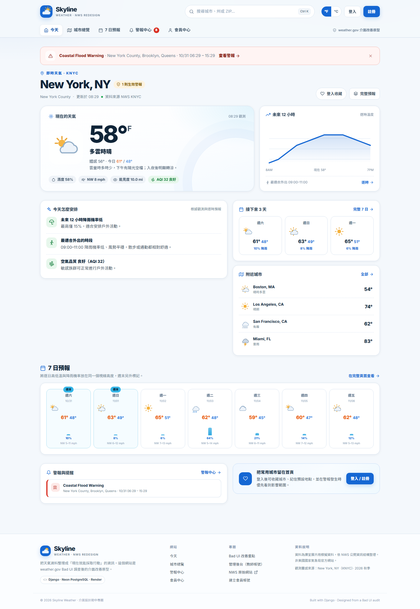

# Skyline Weather

**weather.gov Bad UI 調查後的介面改善原型，也是「使用者介面設計」期中專題的全端實作。**

以 Django 建立可操作的前台網站、Django 管理後台與會員系統，資料庫使用 Neon PostgreSQL，部署平台為 Render。網站延續先前 Bad UI 作業對 weather.gov 的 8 項問題分析與 9 張 Redesign 分鏡，將調查結果實作成 5 個主要頁面。



---

## 1. 專題對應要求

| 課程要求 | 本專題實作 |
| --- | --- |
| 至少 3 個頁面（建議 3–5 個） | 5 個主要頁面：首頁、城市總覽、城市詳情、警報中心、會員中心；另有登入／註冊與警報詳情 |
| 會員登入前後差異 | 訪客可查詢／瀏覽；登入後可收藏城市、設定預設城市、溫度單位、通知管道與警報門檻、查看查詢紀錄 |
| 多元資料查詢／篩選／搜尋 | 城市：關鍵字、區域、天氣、溫度區間、有無警報、排序、分頁；警報：關鍵字、嚴重度、類型、區域、分頁；頁首即時搜尋建議 |
| Django 管理後台 | 城市、即時觀測、每日／逐時預報、警報、會員設定、收藏、查詢紀錄皆可管理；含搜尋、篩選與批次啟停警報 |
| Neon PostgreSQL | 透過 `DATABASE_URL` 連線，前台與後台共用同一資料來源；本機可用 SQLite 開發 |
| 雲端部署 | `render.yaml` + `build.sh`，一鍵建立 Render Web Service；含 Whitenoise 靜態檔與 Gunicorn |
| 至少 10 組 AI Prompt | `docs/AI_PROMPTS.md`（包含前期 Bad UI 作業的 8 組與本期 2 組，共 10 組） |
| 報告 PDF | `docs/report/Skyline_Weather_期中專題報告.pdf`（另附可編輯 PPTX） |

---

## 2. 五個主要頁面

1. **今天（`/`）**：即時觀測、12 小時溫度趨勢、可行動建議（帶傘／最佳外出時段／空氣品質）、3 日與 7 日預報、警報摘要、附近城市。
2. **城市總覽（`/locations/`）**：12 個城市的卡片式列表，支援關鍵字、區域、天氣、溫度區間、有無警報、排序與分頁。
3. **城市詳情（`/locations/<slug>/`）**：24 小時逐時預報、7 日預報、觀測細節、此城市警報、鄰近城市；登入後可收藏。
4. **警報中心（`/alerts/`）**：依嚴重度排序的警報列表，支援嚴重度／類型／區域／關鍵字篩選；詳情頁有建議行動、時間軸與影響範圍示意。
5. **會員中心（`/dashboard/`）**：收藏城市、最近查詢、收藏城市的警報、個人偏好與通知設定。

### 登入前後差異

- **訪客**：可瀏覽與查詢所有公開資料；收藏按鈕會引導登入。
- **會員**：首頁顯示預設城市；可收藏／移除城市、記住 °F/°C、查看查詢紀錄、設定 App／Email／簡訊通知與最低警報嚴重度。
- **管理員**：會員選單可直接進入 Django 管理後台。

---

## 3. 展示帳號

| 角色 | 帳號 | 密碼 | 用途 |
| --- | --- | --- | --- |
| 前台會員 | `demo` | `Demo1234!` | 收藏 3 個城市、首頁預設 New York、已開啟 App/Email 通知 |
| 管理員 | `admin` | `Admin1234!` | 可登入 `/admin/` 管理所有資料 |

> 部署到雲端後，請務必更改這兩組密碼，或建立新的教師測試帳號。種子指令每次執行都會把密碼重設為上述值。

---

## 4. 本機啟動

需求：Python 3.12+（本專案以 Python 3.14 / Django 6.1 開發）。

```powershell
# 1. 建立虛擬環境
python -m venv .venv
.\.venv\Scripts\Activate.ps1

# 2. 安裝套件
pip install -r requirements.txt

# 3. 建立本機設定（可先不填 DATABASE_URL，使用 SQLite）
Copy-Item .env.example .env

# 4. 建立資料表與展示資料
python manage.py migrate
python manage.py seed_demo

# 5. 啟動
python manage.py runserver
```

開啟 <http://127.0.0.1:8000/>。管理後台：<http://127.0.0.1:8000/admin/>。

### 常用指令

```powershell
python manage.py seed_demo            # 重建本週示範資料（會重置預報與警報）
python manage.py seed_demo --if-empty # 僅在資料庫沒有城市時種資料（Render 使用）
python manage.py test forecast        # 執行 12 個測試
python manage.py createsuperuser      # 建立自己的管理員
python manage.py collectstatic        # 收集靜態檔（部署用）
```

---

## 5. Neon PostgreSQL 設定

1. 登入 <https://neon.com/>，建立新 Project（Taiwan 可選 Singapore 區域）。
2. 在 **Connection Details** 選擇 **Pooled connection**，複製 `postgresql://...` 連線字串（結尾需有 `sslmode=require`）。
3. 在本機 `.env` 設定：

   ```dotenv
   DATABASE_URL=postgresql://neondb_owner:密碼@ep-xxx-pooler.ap-southeast-1.aws.neon.tech/neondb?sslmode=require
   ```

4. 將資料表與示範資料寫入 Neon：

   ```powershell
   python manage.py migrate
   python manage.py seed_demo
   ```

5. 重新啟動網站。前台查詢與 Django 後台現在都使用 Neon 的同一份資料。

> 若密碼含特殊字元，請先 URL encode。正式部署時只把 `DATABASE_URL` 放在 Render 的 Environment Variables，不要提交 `.env`。

---

## 6. Render 部署

### 方式 A：Blueprint（推薦）

1. 把專案推到 GitHub（`.env`、`.venv`、`db.sqlite3` 已在 `.gitignore`）。
2. 到 <https://render.com/> → **New** → **Blueprint** → 選擇 repo。
3. Render 會讀取 `render.yaml`，建立 `skyline-weather` Web Service。
4. 在環境變數填入 Neon 的 `DATABASE_URL`（`sync: false` 會要求手動填）。
5. 按下 **Deploy**。建置流程會執行 `bash build.sh`：安裝套件 → `collectstatic` → `migrate` → `seed_demo --if-empty`。
6. 部署完成後開啟：
   - 前台：`https://<service-name>.onrender.com/`
   - 後台：`https://<service-name>.onrender.com/admin/`
   - 健康檢查：`https://<service-name>.onrender.com/healthz/`

### 方式 B：手動 Web Service

- **Build Command**：`bash build.sh`
- **Start Command**：`gunicorn skyline.wsgi:application --bind 0.0.0.0:$PORT --workers 2 --timeout 120`
- **Health Check Path**：`/healthz/`
- 環境變數：

  | Key | Value |
  | --- | --- |
  | `SECRET_KEY` | 隨機長字串（Render 可 Generate） |
  | `DEBUG` | `False` |
  | `DATABASE_URL` | Neon pooled connection string |
  | `ALLOWED_HOSTS` | `.onrender.com`（有自訂網域再補） |
  | `CSRF_TRUSTED_ORIGINS` | `https://*.onrender.com` |
  | `SECURE_SSL_REDIRECT` | `False`（Render 已處理 HTTPS；若要強制轉址可改 `True`） |
  | `PYTHON_VERSION` | `3.13.7` |

### 部署後檢查清單

- [ ] `/healthz/` 回傳 `{"status": "ok", "database": "up"}`
- [ ] 首頁可看到 12 個城市與 New York 的天氣
- [ ] 城市總覽可篩選（例如 `?q=Seattle&region=west`）
- [ ] 以 `demo / Demo1234!` 登入，收藏／移除城市
- [ ] 以 `admin / Admin1234!` 登入 `/admin/`，可新增／修改城市與警報
- [ ] 把前後台連結與測試帳密填入報告

> Render 免費方案會在閒置後休眠，第一次開啟可能需要 30–60 秒。若部署失敗，先看 Build Log 的 `migrate` 或 `collectstatic` 錯誤。

---

## 7. 專案結構

```
.
├─ manage.py
├─ skyline/                 # Django 專案設定、URL、WSGI
├─ forecast/                # 主要 App
│  ├─ models.py             # Location / CurrentConditions / Daily / Hourly / Alert / Profile / Favorite / SearchHistory
│  ├─ views.py              # 5 個頁面、搜尋 API、收藏、會員設定、healthz
│  ├─ admin.py              # 自訂 Django 管理後台
│  ├─ forms.py              # 登入、註冊、會員偏好表單
│  ├─ templatetags/         # 溫度轉換、天氣 SVG、時間與 UI icon
│  ├─ management/commands/  # seed_demo
│  └─ tests.py              # 12 個測試
├─ templates/               # 頁面、partials、自訂 admin 品牌
├─ static/                  # CSS / JS / favicon / admin theme
├─ docs/
│  ├─ screenshots/          # Selenium 擷取的實際網站畫面
│  ├─ AI_PROMPTS.md         # 10 組 Prompt 紀錄
│  ├─ report/               # 期中報告 PDF / PPTX
│  └─ DEPLOY.md             # 部署逐步說明
├─ requirements.txt
├─ build.sh
├─ render.yaml
└─ .env.example
```

---

## 8. 資料模型

- **Location**：城市、州、郡、ZIP、區域、經緯度、時區、測站、海拔、精選。
- **CurrentConditions**：現在溫度、體感、天氣、濕度、風、能見度、氣壓、露點、UV、AQI、今日高低溫、摘要。
- **DailyForecast**：7 日天氣、高低溫、降雨機率、風勢、摘要。
- **HourlyForecast**：逐時溫度、天氣、降雨機率、風速。
- **Alert**：標題、類型、嚴重度、緊急度、影響區域、說明、建議行動、起訖時間、來源、有效狀態。
- **Profile**：顯示名稱、溫度單位、預設城市、通知管道、通知門檻。
- **Favorite**：會員收藏城市（唯一鍵）。
- **SearchHistory**：會員查詢紀錄。

關聯：`Location 1—1 CurrentConditions`、`Location 1—N Daily/Hourly/Alert`、`User 1—1 Profile`、`User 1—N Favorite/SearchHistory`。

---

## 9. 測試

```powershell
python manage.py test forecast -v 2
```

涵蓋：公開頁面、搜尋／篩選、警報篩選、搜尋 API、登入保護、會員偏好更新、收藏切換、°F/°C 切換、註冊建立 Profile、管理員後台、健康檢查、分頁。共 12 個測試。

---

## 10. AI Prompt 與報告

- **AI Prompt 紀錄**：`docs/AI_PROMPTS.md`。共 10 組，包含前期 weather.gov Bad UI 調查的 8 組 Prompt 與本期 2 組實作 Prompt；每組列出使用目的、Prompt、AI 回覆重點與實際成果。
- **期中報告**：`docs/report/Skyline_Weather_期中專題報告.pdf`，另附 `.pptx`（視覺版，逐頁對應 PDF）。
- **網站截圖**：`docs/screenshots/`，由 `scripts/capture_screens.py` 以 Selenium 對實際網站擷取。

### 修改報告中的組別、組員與連結

報告的封面、頁尾與交付頁會讀取 `docs/report/report_meta.json`。填入後執行：

```powershell
# 重新產生 HTML 與 PDF（需要 Chrome）
python scripts/build_report.py

# 從最新 PDF 產生逐頁 PPTX 視覺備份
python scripts/build_pptx.py
```

`report_meta.json` 欄位：

```json
{
  "COURSE": "使用者介面設計",
  "GROUP": "第 3 組",
  "MEMBERS": "王小明（學號）、陳小美（學號）",
  "DATE": "2026.11.01",
  "FRONTEND_URL": "https://skyline-weather.onrender.com/",
  "ADMIN_URL": "https://skyline-weather.onrender.com/admin/",
  "REPO_URL": "https://github.com/your-account/skyline-weather"
}
```

> PDF 是主要繳交檔；PPTX 由 PDF 逐頁輸出，適合直接上台 Demo。若需要修改內文，請改 `report_template.html` 後重跑 `build_report.py`。

### 繳交前必填（重要）

- [ ] `docs/report/report_meta.json`：組別、組員姓名／學號、`FRONTEND_URL`、`ADMIN_URL`、`REPO_URL`。
- [ ] 實際完成 Neon + Render 部署，將連結填入 Meta 並重新產生 PDF。
- [ ] 在報告附錄放入 **10 組 AI 對話截圖**（含 Prompt 與 AI 回覆）；前期 8 組可從 2026-10-18 的 OpenCode 對話截圖，本期 2 組為 2026-10-31 對話。
- [ ] 確認 `demo / Demo1234!` 與 `admin / Admin1234!` 可登入，或改成自己的測試帳密。
- [ ] PDF 上傳 TronClass 作業區（2026/11/01 23:59 前）。

---

## 11. 已知限制

- 氣象資料為**課堂展示用模擬資料**，不是即時 NWS API；資料結構參考 NWS 觀測、預報與 CAP 警報格式。
- 影響範圍圖為示意圖，非精確地理邊界。
- 示範資料以 12 個美國城市為主，介面為繁體中文。
- 部署後若重新執行 `seed_demo` 會重置預報與警報；`build.sh` 使用 `--if-empty` 避免每次部署覆蓋後台修改。
- Render 免費方案會休眠，不適合正式長期服務。

---

## 12. 授權與聲明

本專案為課程作業與介面設計原型，非美國國家氣象局（NWS）官方網站。weather.gov 的原始內容、商標與資料屬於其各自權利人；本專案僅引用公開資訊結構進行學術性介面改善練習。
